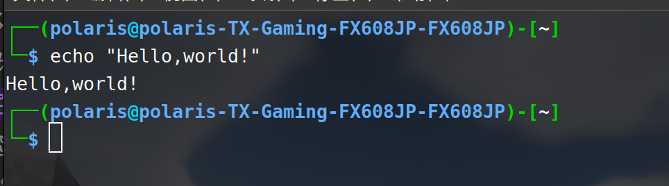

# Kali-style prompt for Oh My Bash

给 Oh My Bash 用的 Kali 风格双行提示符，纯 Bash，无插件依赖。

[English](README.md)

```
┌──(polaris@mint)-[~/projects]
└─$
```

- 双行框线，左侧对齐，不会像 Powerline 主题那样依赖特殊字体
- 颜色、粗体、分隔符（`@` 或 `㉿`）都可单独配置
- 只在交互式 Bash 中生效，不影响脚本、`cron`、GUI 程序启动
- 不替换 `.bashrc`，只追加一个带标记的配置块
- 安装/卸载脚本幂等，可重复执行

## 效果

普通用户（深色背景优化）：

| 部位 | 默认色 | 256 色编号 |
|---|---|---|
| `┌──` `└─` 框线 | 亮绿 | `40` |
| 用户名 / 主机 | 浅蓝 | `75` |
| 中间分隔符 | 亮青 | `45` |
| 路径 | 亮白 | `231` |
| `$` / `#` | 浅蓝 | `75` |


对比度（纯黑背景）：绿 10.7:1，蓝 9.1:1，青 12.2:1，白 21:1，全部远超 WCAG AA。

## 依赖

- Bash 4+
- [Oh My Bash](https://github.com/ohmybash/oh-my-bash)
- `git`（仅安装时用于克隆）
- 可选：想用 `㉿` 的话需要带该字形的字体（Noto CJK、Malgun Gothic 等）

## 安装

```bash
git clone https://github.com/<your-name>/oh-my-bash-kali-prompt.git
cd oh-my-bash-kali-prompt
./install.sh
```

脚本会：

1. 没有 `~/.oh-my-bash` 时自动克隆 Oh My Bash
2. 复制主题到 `~/.oh-my-bash/custom/themes/kali/kali.theme.sh`
3. 备份 `~/.bashrc` 后追加配置块（已存在则跳过，只刷新主题）

打开新终端，或：

```bash
source ~/.bashrc
```

## 手动安装

```bash
git clone --depth 1 https://github.com/ohmybash/oh-my-bash.git ~/.oh-my-bash
mkdir -p ~/.oh-my-bash/custom/themes/kali
cp themes/kali/kali.theme.sh ~/.oh-my-bash/custom/themes/kali/
cat bashrc.snippet >> ~/.bashrc
source ~/.bashrc
```

## 自定义

所有选项都可以在 `~/.bashrc` 的配置块里覆盖，不需要改主题文件。

| 变量 | 默认 | 作用 |
|---|---|---|
| `KALI_PROMPT_BORDER_COLOR` | `40` | 框线颜色 |
| `KALI_PROMPT_ACCENT_COLOR` | `75` | 用户名、主机名 |
| `KALI_PROMPT_PATH_COLOR` | `231` | 路径 |
| `KALI_PROMPT_MARK_COLOR` | 跟随 accent | `$` / `#` |
| `KALI_PROMPT_SEP_COLOR` | `45` | 用户名和主机之间的分隔符 |
| `KALI_PROMPT_HOST_SEP` | `@` | 分隔符字符，改成 `㉿` 即恢复 Kali 原版 |
| `KALI_PROMPT_BOLD` | `1` | `1` 粗体，`0` 常规 |
| `KALI_PROMPT_ROOT_COLOR` | 空 | 设置后 root 整行用该颜色，例如 `196` |

颜色使用 256 色索引。预览全部颜色：

```bash
for i in {0..255}; do printf '\e[38;5;%sm%3d\e[0m ' "$i" "$i"; (( (i+1) % 16 == 0 )) && echo; done
```

### 示例：Kali 原版风格

```bash
KALI_PROMPT_BORDER_COLOR=34
KALI_PROMPT_ACCENT_COLOR=33
KALI_PROMPT_PATH_COLOR=231
KALI_PROMPT_MARK_COLOR=33
KALI_PROMPT_SEP_COLOR=33
KALI_PROMPT_HOST_SEP='㉿'
```

### 示例：真彩色（`#RRGGBB`）

主题默认用 `38;5;N`。想用 RGB，把主题里对应的 `border=` / `accent=` 等行改成：

```bash
border="\[\e[1;38;2;255;121;198m\]"   # #ff79c6
```

## 为什么不用 Kali 的 `㉿`

`㉿`（U+327F）属于东亚宽字符，在部分等宽字体下会渲染成双宽，长命令换行时光标可能错位。默认改用 `@` 更稳；想要原版外观可以设置 `KALI_PROMPT_HOST_SEP='㉿'`。

## 卸载

```bash
./uninstall.sh           # 只移除 ~/.bashrc 里的配置块
./uninstall.sh --purge   # 同时删除主题文件
```

安装和卸载都会先备份 `.bashrc`，备份文件名形如 `.bashrc.bak-20260101-120000`。

## 兼容性说明

Oh My Bash 会自带 `ls`、`grep`、`ll`、`cd` 等别名，可能覆盖发行版默认值。`bashrc.snippet` 在加载 Oh My Bash 之后把常见的几个恢复成发行版习惯，如果你更喜欢 Oh My Bash 的版本，删掉 snippet 末尾的 `alias ...` / `unalias cd` 部分即可。

