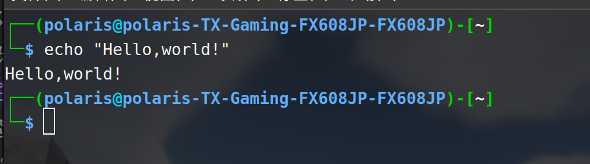

# Kali-style prompt for Oh My Bash

A two-line Kali-style prompt for [Oh My Bash](https://github.com/ohmybash/oh-my-bash). Pure Bash, no plugin dependencies, no Powerline fonts.

[中文说明](README.cn.md)

```
┌──(polaris@mint)-[~/projects]
└─$
```

- Two-line framed layout, left-aligned, no special glyph fonts required
- Colors, bold weight and the user/host separator (`@` or `㉿`) are configured independently
- Only active in interactive Bash — scripts, cron jobs and GUI launchers are untouched
- Never replaces `.bashrc`; it appends a single marked block
- Install and uninstall scripts are idempotent

## Look

Defaults, tuned for dark backgrounds:

| Part | Color | 256-color index |
|---|---|---|
| `┌──` `└─` frame | bright green | `40` |
| user / host | light blue | `75` |
| separator | cyan | `45` |
| path | bright white | `231` |
| `$` / `#` | light blue | `75` |



Contrast against pure black: green 10.7:1, blue 9.1:1, cyan 12.2:1, white 21:1 — all well above WCAG AA.

## Requirements

- Bash 4+
- Oh My Bash
- `git` (install-time only, to clone Oh My Bash)
- Optional: a font containing `㉿` (Noto CJK, Malgun Gothic, …) if you want the original Kali glyph

## Install

```bash
git clone https://github.com/<your-name>/oh-my-bash-kali-prompt.git
cd oh-my-bash-kali-prompt
./install.sh
```

The script will:

1. Clone Oh My Bash to `~/.oh-my-bash` if it is missing
2. Copy the theme to `~/.oh-my-bash/custom/themes/kali/kali.theme.sh`
3. Back up `~/.bashrc` and append the config block (skipped on re-runs; the theme is refreshed instead)

Then open a new terminal, or run:

```bash
source ~/.bashrc
```

## Manual install

```bash
git clone --depth 1 https://github.com/ohmybash/oh-my-bash.git ~/.oh-my-bash
mkdir -p ~/.oh-my-bash/custom/themes/kali
cp themes/kali/kali.theme.sh ~/.oh-my-bash/custom/themes/kali/
cat bashrc.snippet >> ~/.bashrc
source ~/.bashrc
```

## Customization

Every option can be overridden in the block inside `~/.bashrc`; editing the theme file is not required.

| Variable | Default | Purpose |
|---|---|---|
| `KALI_PROMPT_BORDER_COLOR` | `40` | frame color |
| `KALI_PROMPT_ACCENT_COLOR` | `75` | user name and host name |
| `KALI_PROMPT_PATH_COLOR` | `231` | working directory |
| `KALI_PROMPT_MARK_COLOR` | follows accent | `$` / `#` |
| `KALI_PROMPT_SEP_COLOR` | `45` | separator between user and host |
| `KALI_PROMPT_HOST_SEP` | `@` | separator character; set to `㉿` for the Kali glyph |
| `KALI_PROMPT_BOLD` | `1` | `1` bold, `0` normal |
| `KALI_PROMPT_ROOT_COLOR` | empty | when set, the whole root prompt uses this color, e.g. `196` |

Colors are 256-color indexes. Preview the whole palette:

```bash
for i in {0..255}; do printf '\e[38;5;%sm%3d\e[0m ' "$i" "$i"; (( (i+1) % 16 == 0 )) && echo; done
```

### Example: stock Kali look

```bash
KALI_PROMPT_BORDER_COLOR=34
KALI_PROMPT_ACCENT_COLOR=33
KALI_PROMPT_PATH_COLOR=231
KALI_PROMPT_MARK_COLOR=33
KALI_PROMPT_SEP_COLOR=33
KALI_PROMPT_HOST_SEP='㉿'
```

### Example: true color (`#RRGGBB`)

The theme uses `38;5;N` by default. For RGB, change the matching `border=` / `accent=` line in the theme:

```bash
border="\[\e[1;38;2;255;121;198m\]"   # #ff79c6
```

## Why `@` instead of `㉿` by default

`㉿` (U+327F) is East Asian Wide. In some monospace fonts it renders as a double-width glyph, which can confuse readline and misplace the cursor when a long command wraps. `@` is single-width and safer. Set `KALI_PROMPT_HOST_SEP='㉿'` if you prefer the original look.

## Uninstall

```bash
./uninstall.sh           # remove the ~/.bashrc block only
./uninstall.sh --purge   # also delete the theme file
```

Both install and uninstall back up `.bashrc` first, using names like `.bashrc.bak-20260101-120000-123456789`.

## Compatibility notes

Oh My Bash ships its own aliases for `ls`, `grep`, `ll`, `cd` and others, which may override your distro defaults. `bashrc.snippet` restores the common ones after Oh My Bash loads. If you prefer Oh My Bash's versions, delete the trailing `alias …` / `unalias cd` lines from the snippet.

